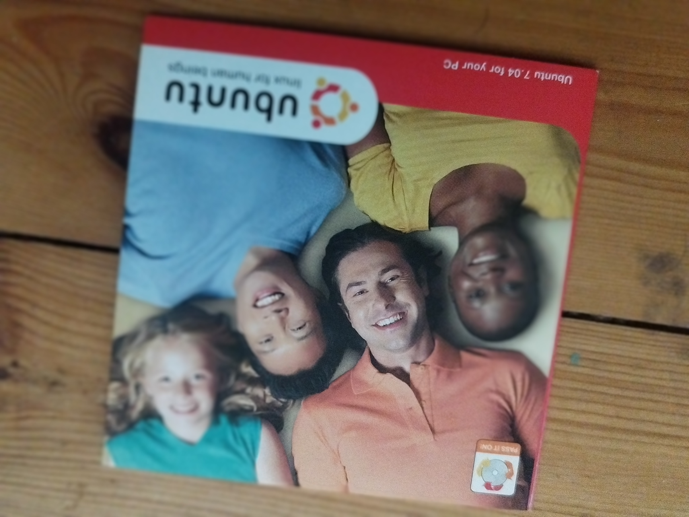

## Context

After a few years (more than I can admit) of using Windows as a personal desktop Operating System, I am once again jumping back into the Linux rabbit hole and trying to use it not only in my day-to-day work, but all the time.

## Ubuntu era

I remember when I first tried to be geeky and install a Linux OS. I was still in high school (mid 2000s), and some friends introduced me to the Linux world. At that time, installing a Linux OS was like a badge of honor. You could join the club of the geeks and call yourself a "hacker" amongst your friends. Of course, I was no hacker by any means, however I was curious enough to go and explore.

At that time, the first Linux OS I stumbled on was Ubuntu. You could order the CDs of the OS online for free and have them delivered to you. I have to admit, when I ordered, I was not expecting to receive any mail. I was living in Casablanca (Morocco), I had never received any mail before at all, let alone from outside of the country. But lo and behold, one day my father comes to me (he was as surprised as I am) with a mail that I received! Yes, it was the first time ever I received a mail to me personally. The good old times.

## Linux through time

Fast forward a few years, I gained a little experience with Linux. It was even the main OS I used during my master's studies. However, it still never felt as straightforward or easy to use as Windows. I always had to have both OS ready to use.

During that time I also did some exploration with other flavours of Linux, I explored for a few months Arch Linux (which was notoriously known to be too bare-bones for beginners), but nothing stuck with me, and I still had a bittersweet experience.

In my professional experience, I worked more on Windows than Linux, however lately I switched to a Mac, which, I think was the best experience as a software engineer. You get an out of the box OS where things just work, with a unix based system where you can do a lot of things.

## Omarchy

Today a new Linux flavor is claiming to have broken that glass ceiling that made Linux only usable for running backend systems. Omarchy (funny name, if you know Arabic), is a new Linux distribution that was launched by DDH and is gaining more and more traction. Although the excitement of receiving a CD by mail for the first time is not there, I am actually excited to go back into that rabbit hole. This time I am bringing with me many years of experience, and many requirements for it to become my go-to OS.

Wish me luck.