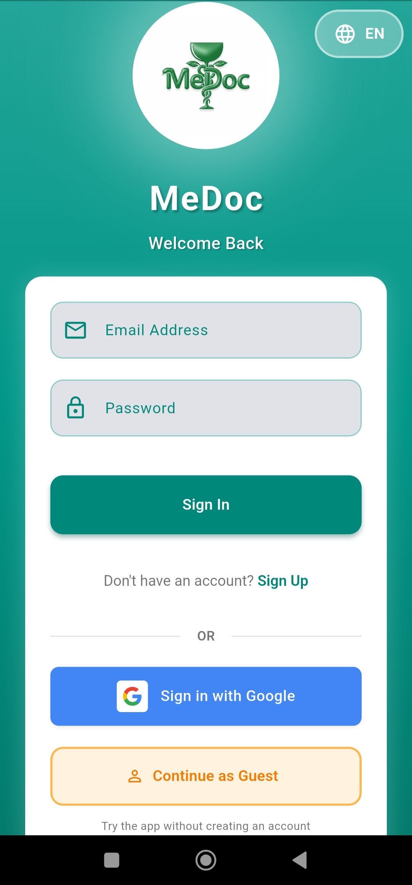
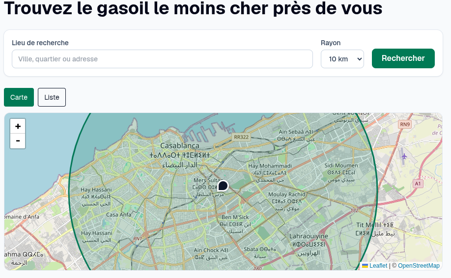

I enjoy building side projects to explore ideas and solve problems that interest me. Here are some of my projects:

## MeDoc

[MeDoc](https://github.com/benayadt/MeDocAppFlutter) is a Flutter app for managing medications and tracking treatments. It includes medication reminders, dose tracking, and a treatment calendar, with AWS Amplify powering the backend.

## Mazout

[Mazout](https://d2ruzj98qzhjtg.cloudfront.net/) is a live, crowdsourced tracker for energy prices.

